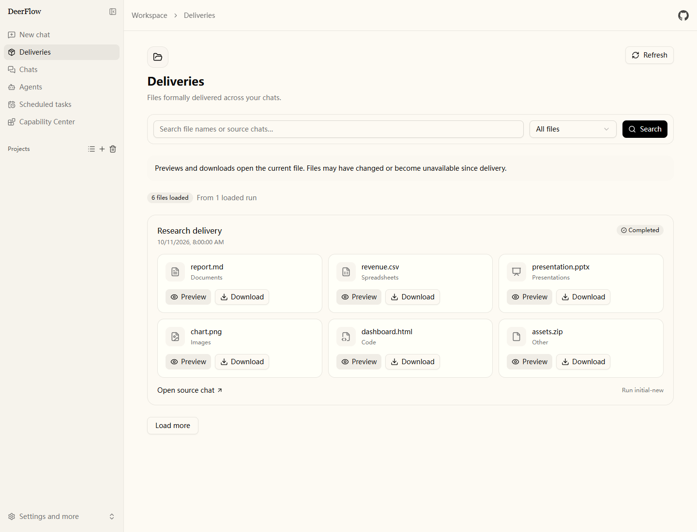
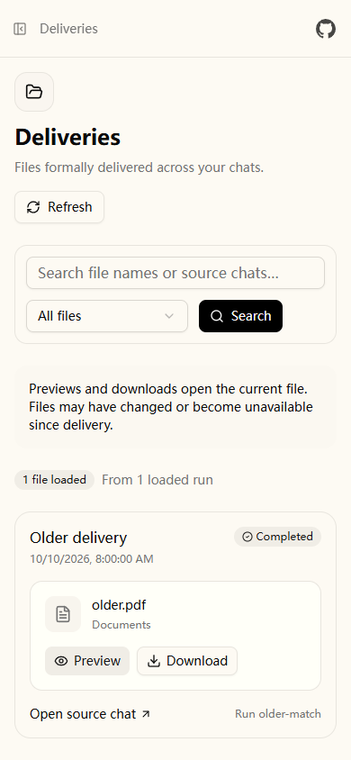

# 成果工作台迭代验收记录

日期：2026 年 10 月 11 日。范围见 [GitHub 复用与成果工作台迭代](../plans/2026-10-11-github-reuse-iteration.md)。

## 交付内容

`/workspace/deliveries` 增加文件名与来源会话搜索、文件类型筛选、清空筛选、已加载计数和响应式文件卡片。预览、下载与来源会话沿用现有功能。后端在当前用户的正式交付凭据范围内筛选，支持 SQL 和内存存储，空扫描窗口仍可继续查找更早的成果。

本轮复用现有 shadcn/ui、TanStack Query、FastAPI 和 SQLAlchemy，没有新增依赖或复制外部源码。GitHub 来源、官方许可证和后续 Docling、Qdrant、FastMCP 候选的接入位置已记录在选型文档。

| 部分 | 实现文件 |
| --- | --- |
| 后端筛选与分页 | `backend/app/gateway/routers/deliveries.py` |
| 页面与文件卡片 | `frontend/src/app/workspace/deliveries/page.tsx`、`frontend/src/components/workspace/deliveries/delivery-card.tsx` |
| 请求与文件类型展示 | `frontend/src/core/deliveries/api.ts`、`frontend/src/core/deliveries/file-type.ts` |
| 双语文案与开发约定 | `frontend/src/core/i18n/locales/{en-US,zh-CN,types}.ts`、`frontend/AGENTS.md`、`backend/app/gateway/AGENTS.md`、`README.md` |

审查同时修复两项内存模式边界：成果响应只包含需要的运行字段，避免带回完整输入与配置；最新活动运行仍推进扫描游标，避免更早的交付被分页提前结束遮住。

## 测试与检查

| 检查 | 结果 |
| --- | --- |
| 后端成果测试 | 46 passed；覆盖查询、类型、组合条件、用户隔离、路径校验、SQL/内存分页、空窗口和数据最小化 |
| 后端成果加权限和分层边界回归 | 54 passed，45.91 秒 |
| 前端完整单元测试 | 1653 passed，207 个文件，无失败或跳过 |
| 前端相关最终回归 | 25 passed，4 个文件；覆盖 API、分类标签、真实 TanStack Query 取消与过期响应、筛选重置、失败重试、计数和 Unicode 长度 |
| 浏览器功能测试 | 4 passed，57.1 秒；API 使用测试夹具，未调用真实模型 |
| 桌面与窄屏复核 | 两项相关浏览器测试通过；保存 1440 像素桌面与 390 像素手机截图，窄屏无页面横向溢出 |
| 前端静态检查 | 完整 ESLint 与 TypeScript `tsc --noEmit` 通过；相关文件 Prettier 通过 |
| 后端静态检查 | 两个修改的 Python 文件 Ruff check 与 format check 通过 |
| 工作区空白检查 | `git diff --check` 通过 |

开发先运行新增后端测试，得到 31 failed / 14 passed，随后实现筛选并转绿。审查阶段的数据最小化与活动运行分页回归先得到 2 failed / 1 passed，修复后转绿。前端检查发现的测试类型声明问题已修正，并重跑相关测试和完整静态检查。

## 修改前后的全量后端限制

普通离线套件使用 `--maxfail=1`：修改前后均为 **1 failed、1732 passed、30 skipped、3 deselected**，停止于 `test_boxlite_shim_workaround_retries_after_fixing_permissions` 的 POSIX 可执行位断言。原有 Windows 文件模式行为没有在本轮修改；未运行到的测试不算通过。修改前的基线排除了当时正在新增的成果测试，这部分另行完成红灯和最终定向验证。

严格 blocking-I/O 套件修改前为 **5 failed、138 passed、1 skipped**，修改后为 **4 failed、139 passed、1 skipped**。持续失败的是运行配置文件的三个 POSIX 权限断言和缺少 `lark-cli` 的集成测试；修改前另一个动态上下文时序用例在修改后的运行中通过。本轮没有改动这些模块，也没有宣称全量后端门禁通过。

## 继续验证

后续复核修正了默认测试入口中的真实模型泄漏：`test_client_e2e.py` 和 `test_create_omniharness_agent_live.py` 的模型用例现在带有 `live` 标记，只有设置 `OMNI_HARNESS_RUN_LIVE_TESTS=1` 且提供 API key 才会执行；无模型的文件、配置和边界用例仍参加离线套件。Windows 下 live 策略测试的嵌套 pytest 已补充系统环境变量传递；缺少 GNU Make 的主机只跳过依赖该命令的 dry-run 检查。

本次继续复核的结果：相关后端回归 **851 passed、1 skipped**；浏览器与无头抓取回归 **113 passed、1 skipped**；Windows 沙箱回归 **10 passed**；严格 blocking-I/O 门禁 **141 passed、3 skipped**；前端单元测试 **1653 passed**，ESLint 与 TypeScript 检查通过，后端 Ruff lint/format 通过。

普通离线全套在 UTF-8 环境并关闭 live opt-in 后，两次均运行到约 21%，在未修改的 `tests/test_delta_channel_state.py::test_merge_message_writes_randomized_differential` 上触发 Hypothesis `too_slow` 健康检查；每次此前已有 **3721 passed、61 skipped、17 deselected**。随后仅在诊断命令中排除该用例，套件继续到 **3722 passed**，并在同文件的 `test_merge_message_writes_randomized_batching_invariance` 上触发同类健康检查。两个失败 seed 及对应测试单独重放均通过，说明这是 Windows 全量运行时的 Hypothesis 生成耗时波动；未关闭健康检查，因此仍不宣称普通全量门禁通过。

浏览器使用已安装的 Chrome 和临时 Next.js Webpack dev server（3021），保留项目默认 Playwright 配置。首次检查曾受服务中断、冷编译和开发时热重载影响，稳定后四项用例通过。截图包含测试夹具文件，展示页面结构与交互，不代表真实用户交付内容。

## 页面截图

桌面截图：



手机截图：



## 复现命令

在 `backend/` 使用现有虚拟环境：

```powershell
& ./.venv/Scripts/python.exe -m pytest tests/test_deliveries_router.py tests/test_auth_me_permissions.py tests/test_harness_boundary.py -q
& ./.venv/Scripts/ruff.exe check app/gateway/routers/deliveries.py tests/test_deliveries_router.py
& ./.venv/Scripts/ruff.exe format --check app/gateway/routers/deliveries.py tests/test_deliveries_router.py
$env:PYTHONPATH='.'; $env:PYTHONIOENCODING='utf-8'; $env:PYTHONUTF8='1'; $env:OMNI_HARNESS_RUN_LIVE_TESTS='0'
& ./.venv/Scripts/python.exe -m pytest -m 'not live' --ignore=tests/blocking_io tests/ -q --maxfail=1
& ./.venv/Scripts/python.exe -m pytest tests/blocking_io -q --tb=short
```

在 `frontend/`：

```powershell
& ./node_modules/.bin/rstest.cmd run
& ./node_modules/.bin/eslint.cmd . --ext .ts,.tsx
& ./node_modules/.bin/tsc.cmd --noEmit
& ./node_modules/.bin/playwright.cmd test tests/e2e/deliveries.spec.ts
```

标准浏览器命令需要项目指定的 Chromium。本机临时配置存于忽略目录 `.next/workbarley.playwright.config.ts`，指定已安装的 Chrome 和 3021 dev server，可在启动该服务后用 `playwright.cmd test --config .next/workbarley.playwright.config.ts` 复现。
